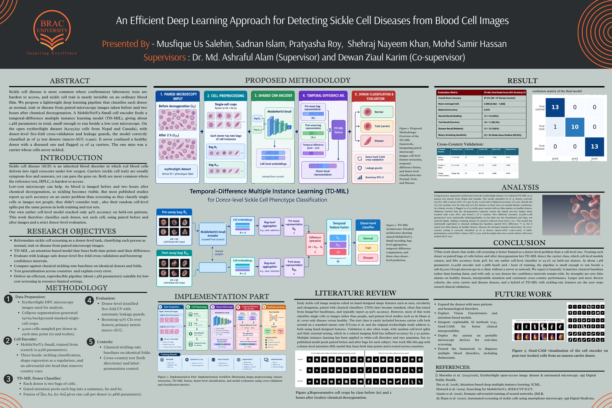
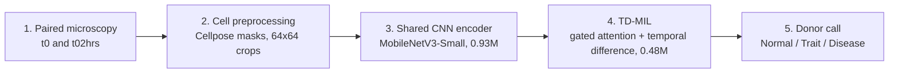

# An Efficient Deep Learning Approach for Detecting Sickle Cell Diseases from Blood Cell Images
 
**Donor-level screening of Normal / Trait (carrier) / Disease from paired blood-cell microscopy, using Temporal-Difference Multiple Instance Learning (TD-MIL).**
 
Undergraduate thesis (B.Sc. in Computer Science and Engineering), Department of Computer Science and Engineering, **BRAC University**, 2026.
Thesis group ID: **T2530925**
 
> **Screening, not diagnosis.** This work is a research prototype for low-resource screening. A laboratory test (HPLC) is still required to confirm any result.
 

 
---
 
## Contents
 
- [TL;DR](#tldr)
- [Repository contents](#repository-contents)
- [Why this problem](#why-this-problem)
- [Research objectives](#research-objectives)
- [Method](#method)
- [Dataset](#dataset)
- [Experimental protocol](#experimental-protocol)
- [Results](#results)
- [Comparisons](#comparisons)
- [Interpretability](#interpretability)
- [Error analysis](#error-analysis)
- [Limitations](#limitations)
- [Future work](#future-work)
- [Contributions](#contributions)
- [Key references](#key-references)
- [Team](#team)
- [Citation](#citation)
- [License and data attribution](#license-and-data-attribution)
---
 
## TL;DR
 
Sickle cell disease (SCD) is most common where confirmatory lab tests (HPLC) are hardest to access, and **carriers (sickle cell trait, SCT) look normal on an ordinary blood smear**. We reformulate the problem at the **donor level**: each person is represented by two "bags" of red-blood-cell crops, one imaged **before** (t0) and one **two hours after** (t02hrs) chemical deoxygenation. A tiny MobileNetV3-Small encoder embeds each cell, and a **TD-MIL** head (gated attention pooling plus a temporal-difference fusion vector) produces one call per donor.
 
| Headline result (37 held-out test donors, donor-level 5-fold CV) | Value |
|---|---|
| Donor accuracy | **97.3 %** (36 / 37) |
| Macro-AUC | **0.990** (95 % CI 0.962 to 1.000) |
| Balanced accuracy | **0.970** |
| Normal recall / Trait recall / Disease recall | 13/13 · 10/11 · 13/13 |
| Healthy donors falsely flagged | **0 / 13** |
| Normal vs Disease confusions | **0** |
| Sickle-gene detection (trait + disease) | 23 / 24 sensitivity (95.8 %), 13 / 13 specificity |
| Model size | **~1.4 M parameters** (0.93 M encoder + 0.48 M head), ~5.6 MB |
| Training time | about 1 hour for the frozen split, about 1.5 h with the expanded training set |
 
The one remaining error is **SCT-002**, a carrier whose cells essentially never sickled (measured change 0.34 %, inside the healthy range). It is an assay limitation, not a classifier failure: every method we tried misses this donor.
 
> **Honest framing:** TD-MIL is **statistically equivalent** to strong classical sickling-rate baselines (paired macro-AUC difference interval includes zero). Its advantage is the *error profile*: zero false alarms on healthy donors, where the strongest baseline raised three.
 
---
 
## Repository contents
 
```
.
├── README.md
├── poster/
│   └── sickle-cell-tdmil-poster.png      # research poster
├── slides/
│   ├── sickle-cell-tdmil-slides.pptx     # defense slides (editable)
│   └── sickle-cell-tdmil-slides.pdf      # (optional) PDF export for in-browser preview
└── thesis/
    └── sickle-cell-tdmil-thesis.pdf      # full thesis report
```
 
| Item | Description |
|---|---|
| **Poster** | One-page summary shown at the BRAC University thesis poster exhibition |
| **Slides** | 23-slide defense deck: background, gap analysis, architecture, results, ablations, interpretability, limitations |
| **Thesis** | Full report (about 111 pages): literature review, methodology, results, statistical analysis, discussion |
 
---
 
## Why this problem
 
- **SCD** (HbSS): red blood cells deform into rigid crescents under low oxygen, blocking vessels and damaging organs.
- **SCT** (HbAS, carriers): usually symptom-free and unaware, but can pass the gene on. Their cells look normal until deoxygenated, so they are the class most easily missed.
- **HPLC**, the reference test, is expensive and scarce exactly where SCD is most prevalent.
- A low-cost route: a sub-**US$3,000** Octopi differential-phase-contrast (DPC) microscope plus a chemical deoxygenation step (2 % sodium metabisulfite, Na₂S₂O₅), imaged at t0 and t02hrs.
### Three flaws in the existing literature this thesis addresses
 
1. **Wrong unit of analysis.** Most AI work classifies single cells or single photographs, not one clinical decision per person.
2. **Neglected carrier class.** Trait is rarely modelled; many studies only separate disease from healthy.
3. **Data leakage.** Randomly splitting cells puts the same person in both train and test, inflating accuracy by roughly 5 to 30 points.
Our own earlier cell-level classifier reached only **49 % accuracy on held-out patients**, which motivated the redesign.
 
---
 
## Research objectives
 
1. Reformulate sickle cell screening as a **donor-level** task: one call (Normal, Trait or Disease) per person from paired images.
2. Build **TD-MIL**, an attention-based model that fuses both time points **and their difference**.
3. Evaluate with **leakage-safe donor-level stratified 5-fold cross-validation** and bootstrap confidence intervals.
4. Compare against **classical sickling-rate baselines** on identical donors and folds.
5. Test **cross-country generalisation** and explain every error.
6. Deliver an **efficient, reproducible pipeline (~1.4 M parameters)** suitable for low-cost, resource-limited settings.
**Core research question:** *How can we build an end-to-end, donor-level model that classifies Normal, Trait and Disease from paired time-point images while guaranteeing zero data leakage?*
 
---
 
## Method
 
### Five-stage pipeline
 

 
| Stage | What happens |
|---|---|
| **1. Paired input** | Each donor is imaged before (t0) and 2 hours after (t02hrs) chemical deoxygenation. |
| **2. Preprocessing** | Cellpose segmentation (shipped with the dataset) gives single-cell **64 × 64** background-masked crops. **4,000 cells are sampled per donor per time point** (equal donor weighting). Border-clipped cells are removed. |
| **3. Cell encoder** | Single-channel **MobileNetV3-Small**, trained from scratch (0.93 M params, 576-d embedding) with three heads: a **sickling head** (primary, binary cross-entropy), a **morphology head** (Smooth-L1 regression of 6 shape parameters, acts as a regulariser) and an adversarial **site head** (gradient-reversal layer, removes country/hospital batch effects). |
| **4. TD-MIL** | Shared projection (576 → 256), then **gated attention pooling** summarises Bag B₀ into **h₀** and Bag B₂ₕ into **h₂**. Fusion vector **z = [h₀, h₂, h₂ − h₀] ∈ ℝ⁷⁶⁸** feeds Linear(768→256) → ReLU → Dropout → Linear(256→3). Head = 0.48 M params. |
| **5. Decision** | One three-class call per donor, evaluated with donor-level 5-fold CV and bootstrap 95 % CIs. |
 
### Key hyper-parameters
 
| Component | Setting |
|---|---|
| Encoder training | AdamW, batch 256, LR 5e-4, 2-epoch warm-up, weight decay 1e-4, up to 20 epochs (early stop after 6), mixed precision, dihedral augmentation |
| Encoder loss weights | sickling 1.0 · morphology 0.3 · site 0.1 (through gradient reversal) |
| TD-MIL | gated attention (128), dropout 0.1 / 0.25, LR 1e-4 or 3e-4, 8 donors per step, 512 cells sampled per bag per step, up to 200 epochs (early stop after 40) |
| Inference | all 4,000 cells per bag |
| Tuning | LR, dropout, hidden size and bag size chosen **per fold on validation donors** from a 16-point grid |
| Seeds | 3 per fold for exploratory runs, 5 for the proposed model |
 
---
 
## Dataset
 
Public **erythroSight** release (Shrestha et al.), DOI [`10.20383/103.0916`](https://doi.org/10.20383/103.0916), **CC BY 4.0**. Imaged with Octopi microscopes at sites in **Nepalgunj (Nepal)** and **Vancouver (Canada)**; genotypes confirmed by HPLC.
 
| Prefix | Class used | Site | Genotype | Donors | Fields |
|---|---|---|---|---:|---:|
| N | Normal | Canada | HbAA | 6 | 180 |
| AA | Normal | Nepal | HbAA | 8 | 240 |
| SCT | Trait | Canada | HbAS | 7 | 210 |
| AS | Trait | Nepal | HbAS | 12 | 360 |
| SCD | Disease | Canada | HbSS or HbS/β-thal | 5 | 150 |
| SS | Disease | Nepal | HbSS | 4 | 120 |
| SBeta | Disease | Nepal | HbS/β-thal | 4 | 120 |
| ABeta | *Excluded (negative control)* | Nepal | HbA/β-thal, no HbS | 3 | 90 |
| **Total** | | | | **49** | **1,470** |
 
| Quantity | Value |
|---|---|
| Fields of view | 1,470 (49 donors × 2 time points × 15 fields) |
| Segmented cells | **8,077,631** |
| Test cohort | **37 donors** (13 Normal, 11 Trait, 13 Disease), unchanged throughout the study |
| Training cohort | 46 donors (the original 37 plus 9 added; Nepal 28, Canada 18 overall) |
| Cells used per donor per time point | 4,000 (392,000 crops, 64 × 64, 1.31 GB) |
| Crop truncation | affects only 0.060 % of sickled cells (208 of 6.52 M) |
 
### The assay signal (measured on all 8,077,631 cells)
 
| Class | Sickled fraction at t0 | Sickled fraction at t02hrs | Change |
|---|---:|---:|---:|
| Normal | 0.0039 | 0.0045 | +0.0007 |
| Trait | 0.0017 | 0.0698 | +0.0681 |
| Disease | 0.0423 | 0.3155 | +0.2733 |
 
Healthy cells do not react, carriers react weakly (hence missed by ordinary smears), patients react strongly. The **difference between the two photographs is the diagnostic signal**.
 
---
 
## Experimental protocol
 
- **Donor-level stratified 5-fold CV**, stratified by genotype class and acquisition country (32 to 34 train, 6 validation, 7 to 8 test donors per fold). Every donor is tested exactly once by a model that never saw it.
- **Programmatic leakage guards** assert before every epoch that no test donor appears in training, scaling or tuning. They fired **15 / 15** times with zero violations.
- **Label-permutation control:** shuffle training labels, keep test labels. Performance should collapse to chance.
- **Bootstrap 95 % CIs over donors** on every reported number; paired bootstraps for comparisons.
- **Classical baselines** (B0, B1, B2, RULE) run on identical donors and folds.
- **Cross-country tests** in both directions.
- **ABeta donors** (β-thalassaemia trait, no sickle gene) held out as a negative control.
### Label-permutation control (5 rounds)
 
| | macro-AUC | Balanced acc. | Donors correct |
|---|---:|---:|---:|
| Chance level | 0.500 | 0.333 | n/a |
| **Mean over 5 rounds** | **0.521** | **0.386** | **14.0 / 37** |
 
With labels destroyed the model is at chance, which is strong evidence that the reported figures are not inflated by leakage.
 
---
 
## Results
 
### Main result (out-of-fold, 37 test donors)
 
| Metric | TD-MIL final model |
|---|---|
| Overall donor accuracy | **97.3 %** (36 / 37) |
| Macro-averaged AUC | **0.990** [0.962, 1.000] |
| Balanced accuracy | 0.970 |
| Normal recall (healthy) | 13 / 13 (100 %) |
| Trait recall (carriers) | 10 / 11 (90.9 %) |
| Disease recall (patients) | 13 / 13 (100 %) |
| Binary screening (sickle gene positive) | 23 / 24 sensitivity (95.8 %), 13 / 13 specificity |
| Expected calibration error (ECE) | 0.045 (slightly under-confident) |
| Lowest per-donor confidence | 0.742 (no donor falls below a 0.60 referral threshold) |
| Reproducibility | 5 seeds reproduce 36 / 37 (macro-AUC 0.988) |
 
**Confusion matrix** (rows = true class, columns = predicted):
 
| | Pred. Normal | Pred. Trait | Pred. Disease |
|---|---:|---:|---:|
| **True Normal** | 13 | 0 | 0 |
| **True Trait** | 1 | 10 | 0 |
| **True Disease** | 0 | 0 | 13 |
 
### Cell encoder validation (donors unseen by the encoder)
 
| Fold | Validation sickling AUC | Spearman ρ with measured elongation |
|---:|---:|---:|
| 0 | 0.999 | 0.90 |
| 1 | 0.999 | 0.81 |
| 2 | 1.000 | 0.83 |
| 3 | 1.000 | 0.79 |
| 4 | 1.000 | 0.83 |
 
The site-adversarial head predicted country no better than the majority baseline (+0.00), so the encoder keeps no usable country shortcut.
 
### Ablation over inputs and feature source
 
Same donors and folds, 3 seeds averaged.
 
| Variant | macro-AUC [95 % CI] | Balanced acc. | Trait found | Donors correct | Proposed minus variant (macro-AUC) |
|---|---|---:|---:|---:|---|
| Before only (h₀) | 0.697 [0.572, 0.809] | 0.485 | 5/11 | 18/37 | +0.269 [+0.163, +0.383] |
| After only (h₂) | 0.973 [0.917, 1.000] | 0.848 | 6/11 | 32/37 | −0.007 [−0.047, +0.022] |
| Before + after (h₂, h₀) | 0.959 [0.896, 1.000] | 0.914 | 9/11 | 34/37 | +0.007 [−0.005, +0.027] |
| Change only (h₂ − h₀) | 0.943 [0.853, 1.000] | 0.944 | 10/11 | 35/37 | +0.023 [+0.000, +0.068] |
| **Full TD-MIL (h₂, h₀, h₂ − h₀)** | **0.990 [0.962, 1.000]** | **0.970** | **10/11** | **36/37** | n/a |
| Hand-measured descriptors instead of CNN | 0.946 [0.872, 1.000] | 0.893 | 10/11 | 33/37 | +0.020 [−0.004, +0.058] |
| Descriptor model + extra training donors | 0.994 [0.977, 1.000] | 0.921 | 11/11 | n/a (different 36-donor split) | −0.030 [−0.090, +0.012] |
 
**Takeaways**
 
- The **pre-test photo alone is near-useless** (AUC 0.697): the signal is in the *reaction*.
- Post-test alone is already strong, and **change-only gives the best single-input carrier recall (10/11)**.
- Only removing the post-test information produces a clearly significant drop. With 37 donors, differences below about 0.05 macro-AUC cannot be resolved.
- Hand-measured descriptors nearly match the CNN: **learned features add little**; the formulation and the data matter more.
### Encoder backbone comparison (five encoders inside the same TD-MIL)
 
All trained from scratch, same donors and folds. Training time is for all five folds.
 
| Encoder | Params | Train time (h) | Throughput (img/s) | macro-AUC [95 % CI] | Bal. acc. | Normal | Trait | Disease | Correct |
|---|---:|---:|---:|---|---:|---:|---:|---:|---:|
| MobileViT-XXS (stock) | 0.95 M | 2.19 | 7,365 | 0.976 [0.937, 1.000] | 0.853 | 13/13 | 7/11 | 12/13 | 32 |
| ResNet-18 (stock) | 11.18 M | 1.47 | 11,160 | 0.973 [0.917, 1.000] | 0.914 | 13/13 | 9/11 | 12/13 | 34 |
| **MobileNetV3-Small (selected)** | **0.93 M** | **1.0** | **14,679** | 0.972 [0.918, 1.000] | 0.914 | 13/13 | 9/11 | 12/13 | 34 |
| Adapted ResNet-18 (development version) | 11.17 M | 14.78 | 1,008 | 0.966 [0.910, 1.000] | 0.883 | 13/13 | 8/11 | 12/13 | 33 |
| ConvNeXt-Pico (stock) | 8.53 M | 16.3 | 17,133 | 0.952 [0.872, 1.000] | 0.858 | 12/13 | 8/11 | 12/13 | 32 |
 
**Key finding: backbone saturation.** All five backbones reach saturated cell-level sickling AUC (about 0.999), and every paired difference interval contains zero. The bottleneck is the **problem formulation and the data**, not network depth. MobileNetV3-Small was chosen **purely on compute cost**.
 
| Cost | Adapted ResNet-18 | MobileNetV3-Small |
|---|---:|---:|
| Backbone parameters | 11.17 M | **0.93 M** (about 12× fewer) |
| Encoder training (5 folds) | 14.78 h | **1 h** (about 15× faster) |
| Throughput | 1,008 img/s | **14,679 img/s** |
| Peak GPU memory | 6.7 GB | **4.5 GB** |
 
### Effect of adding nine training donors
 
Eight of the nine added donors are carriers (six Nepali AS, two Canadian SCT), plus one Canadian normal donor. The 37 test donors and folds are unchanged.
 
| | 37 training donors | **46 training donors** |
|---|---:|---:|
| macro-AUC | 0.972 [0.918, 1.000] | **0.990** [0.962, 1.000] |
| Balanced accuracy | 0.914 | **0.970** |
| Normal recall | 13/13 | 13/13 |
| Carrier recall | 9/11 | **10/11** |
| Disease recall | 12/13 | **13/13** |
| Donors correct | 34/37 | **36/37** |
 
Two donors moved from wrong to right. The gain is reported as exploratory: the interval includes zero, and resolving 34/37 vs 36/37 would need a larger test cohort.
 
---
 
## Comparisons
 
### Against classical sickling-rate baselines
 
Macro-AUC / balanced accuracy.
 
| Model | Features | 73 donors (original investigators' data) | 37 donors (our data) |
|---|---|---|---|
| B0 | ΔS only | 0.940 / 0.779 | 0.936 / 0.767 |
| B1 | S(t0), S(t02hrs), ΔS | 0.951 / 0.837 | 0.963 [0.910, 0.998] / 0.853 (32/37 correct) |
| B2 | B1 + shape distribution statistics | 0.969 [0.934, 0.994] / 0.842 | 0.947 / 0.893 [0.787, 0.978] |
| RULE | two learned thresholds | n/a | 30 of 37 donors correct |
| **TD-MIL (ours)** | raw paired cell images | n/a | **0.990 [0.962, 1.000] / 0.970 (36/37 correct)** |
 
- On identical donors and folds, the paired macro-AUC difference against the best baseline is **statistically indistinguishable from zero** (CI includes 0).
- **Clinical edge:** B2 raised **3 false alarms** on healthy donors; TD-MIL raised **zero**, and correctly detected weakly sickling carriers that rate-based models missed.
- Why no big win? The assay is designed so that one scalar (the change in elongated-cell fraction) almost answers the question. A general learner can match a near-sufficient domain measurement but has little headroom to beat it.
### Against the earlier version of this work
 
| Aspect | Earlier version | Proposed model |
|---|---|---|
| Unit of analysis | single cell | **one decision per donor** |
| Time points used | mostly one (t02hrs in stage 2) | **both, fused with their difference** |
| Donors | 17 (3 held out for test) | **37 test donors, every donor tested once** |
| Model | two-stage cascade (binary ResNet-18) | **MobileNetV3-Small + TD-MIL attention pooling** |
| Leakage control | patient-level split, no automated check | **donor-level folds plus guards that abort on violation** |
| Uncertainty | not reported | **bootstrap CIs over donors on every number** |
| Baselines | none | **B0, B1, B2, RULE on identical folds** |
| Robustness tests | none | **cross-country (both directions), ABeta control** |
| Headline | 49 % accuracy on 13,988 cells; trait recall near zero at t0 | **36/37 (97 %), macro-AUC 0.990** |
 
The two headlines are not directly comparable because the unit of analysis changed; that is the point. The earlier result is reported as motivation.
 
### Across countries (train on one country, test on the other)
 
| Direction | Training donors | Test donors | Correct | macro-AUC | Balanced acc. |
|---|---:|---:|---:|---:|---:|
| Nepal → Canada | 18 | 15 | 12/15 | 0.967 | 0.800 |
| Canada → Nepal | 28 | 22 | 17/22 | 0.965 | 0.750 |
| Pooled | single site only | 37 | 29/37 (78.4 %) | 0.935 | 0.776 |
 
Within each direction, macro-AUC falls by only about 0.023 to 0.025, but balanced accuracy drops by 0.17 to 0.22. The learned representation still **ranks** unseen-site donors well above chance; most of the lost accuracy is consistent with **site-specific decision thresholds** (Canadian carriers change by 8 to 17 % after deoxygenation, Nepali carriers only 0.3 to 3 %). This is an interpretation, not something the experiment isolates. Site-specific thresholds or including target-site donors in training are the natural remedies, still to be tested.
 
### Against the literature
 
| System | Task and cohort | Result |
|---|---|---|
| **TD-MIL (this work)** | normal / trait / disease, 37 test donors, donor-level 5-fold CV | 36/37 (97 %), macro-AUC 0.990 [0.962, 1.000] |
| Original erythroSight study (Shrestha et al.) | normal / trait / disease, 138 participants, repeated 80:20 splits | AUC 0.940 (trait group incl. ABeta); 0.962 for the closest grouping |
| de Haan et al. 2020 | disease vs healthy, 96 blind patients (2-class) | about 98 %, AUC 0.998 |
| D'Costa et al. 2024 | healthy / trait / disease, 35 blind samples | 35/35 |
| Kazeminia et al. 2022 | 5 rare anaemias incl. SCD, 71 participants | 78.7 % |
| Typical cell-level papers | single cell or image, sickle vs normal (2-class) | 95 to 99 % |
 
These cohorts and protocols are **not commensurable**; the only like-for-like comparison is the classical baselines on identical donors and folds. High numbers in the literature often solve the easier disease-vs-healthy question, whereas the trait class is where our single remaining error sits.
 
### Identified research gap
 
No published work we found combines **two time-point cell bags** using **gated attention** and an **explicit temporal-difference vector [h₀, h₂, h₂ − h₀]** for **three-class phenotype screening** under **strict leakage-guarded cross-validation**.
 
---
 
## Interpretability
 
- **Attention weights (TD-MIL).**
  - *Disease donors:* attention concentrates on irreversibly sickled cells at t0 (about **9.6×** the bag average) and sickled crescents at t02hrs.
  - *Carrier donors:* attention concentrates on mildly elongated cells appearing only after deoxygenation (about **5.9×** the bag average).
  - *Healthy donors:* attention is flat, with no sickling signal to find.
- **Grad-CAM** on the cell encoder shows it responds to the **body and curved edge of elongated cells**, not to background padding or mask boundaries.
- **Calibration:** ECE 0.045 (slightly under-confident), a safe direction for screening.
- **Abstention:** a probability threshold of 0.60 can flag low-confidence cases for confirmatory HPLC. The final model's lowest confidence is 0.742, so no donor is referred, including the one it gets wrong; the rule does separate weaker encoders.
---
 
## Error analysis
 
| Error type | Donors | Same donor wrong in every encoder? | Confidence when wrong | Final model |
|---|---|---|---|---|
| **Input failure** | SCT-002 (trait → normal) | Yes, 5 of 5 | 0.98 to 1.00 | **Still wrong** (the single error) |
| **Borderline carrier** | AS-004, AS-005, AS-006 | No; none wrong in all 5 | 0.53 to 0.94; five of eight wrong calls below 0.65 | No AS donor wrong in the final model |
| **Misread before-bag** | SS-003 (disease → trait) | Yes, 5 of 5 | 0.77 to 0.99 | Correct after the training-set expansion |
 
**SCT-002 is the irreducible one:** its measured change of 0.34 % lies inside the healthy range (largest normal value 0.49 %). The classical baseline, every ablation variant, all five encoders and both cross-country models miss it. There is no signal in the images to recover; the assay itself did not separate this person from a healthy one.
 
---
 
## Limitations
 
- **Small cohort.** With N = 37 test donors, one donor equals 2.7 % accuracy, so confidence intervals stay wide and 34/37 vs 36/37 cannot be statistically separated.
- **Assay false-negative bound.** Samples that do not react chemically (like SCT-002) cannot be identified from images alone.
- **No multiplicity correction.** Ablations, five encoders and the expanded training set were all evaluated on the same 37 test donors; everything beyond the primary ablation is exploratory.
- **Auxiliary head bottleneck.** Shape R² dropped on the expanded training set due to the capacity of a single linear layer across diverse imaging regions.
- **Scope.** DPC images from Octopi microscopes only; brightfield smears or smartphone adapters would need retraining.
- **Reagent dependency.** The protocol still needs manual preparation of the deoxygenation agent (Na₂S₂O₅).
- **Cross-country drop.** Accuracy falls to about 78 % across countries, so site adaptation or site-specific thresholds are needed.
---
 
## Future work
 
- Multi-centre clinical validation (e.g. sub-Saharan Africa and South Asia) and a larger test cohort.
- Microfluidic integration to automate deoxygenation (lab-on-a-chip).
- Mobile-phone adaptation: compress the encoder for phone-mounted lenses.
- Pre-registered abstention bands (p < 0.60 referral to HPLC).
- Use every field of view for train, validation and test.
- Add transformer attention so cells can attend to each other, and explore Vision Transformers.
- Use more time points; extend to other blood disorders (e.g. thalassaemia).
- Hybridise TD-MIL with sickling-rate features; deploy on portable microscopy for real-time screening.
---
 
## Contributions
 
1. **First MIL formulation of the sickling test:** donor classification as bags of cells, enabling carrier detection that cell-level models cannot do.
2. **Temporal state-vector fusion:** pre- and post-deoxygenation bags fused as [h₀, h₂, h₂ − h₀] to capture the dynamic chemical response.
3. **Backbone-saturation finding:** five CNN/ViT backbones perform equivalently, so the bottleneck is formulation and data, not depth.
4. **Edge-deployable system:** ~1.4 M parameters, 97.3 % donor accuracy, 0.990 macro-AUC, zero healthy false alarms.
5. **Rigorous evaluation protocol:** donor-level CV, automatic leakage guards, label-permutation control, bootstrap CIs, cross-country test.
6. **Honest comparison:** statistically equivalent to classical baselines, but with a different, clinically friendlier error profile.
---
 
## Key references
 
- Shrestha et al. (2024/2026). *erythroSight open-access image dataset and automated microscopy.* npj Digital Public Health.
- Ilse et al. (2018). *Attention-based deep multiple instance learning.* ICML.
- Howard et al. (2019). *Searching for MobileNetV3.* IEEE/CVF ICCV.
- Ganin et al. (2016). *Domain-adversarial training of neural networks.* JMLR.
- de Haan et al. (2020). *Automated screening of sickle cells using smartphone microscopy.* npj Digital Medicine.
The full bibliography is in the [thesis PDF](thesis/sickle-cell-tdmil-thesis.pdf).
 
---
 
## Team
 
| Name | Role |
|---|---|
| Musfique Us Salehin | Author |
| Sadnan Islam | Author |
| Shehraj Nayeem Khan | Author |
| Pratyasha Roy | Author |
| Mohd Samir Hassan | Author |
 
**Supervisor:** Dr. Md. Ashraful Alam, Department of Computer Science and Engineering, BRAC University
**Co-supervisor:** Dewan Ziaul Karim, Senior Lecturer, Department of Computer Science and Engineering, BRAC University
 
The thesis was selected for the BRAC University thesis poster exhibition.
 
---
 
## Citation
 
```bibtex
@thesis{salehin2026tdmil,
  title   = {An Efficient Deep Learning Approach for Detecting Sickle Cell Diseases from Blood Cell Images},
  author  = {Salehin, Musfique Us and Islam, Sadnan and Khan, Shehraj Nayeem and Roy, Pratyasha and Hassan, Mohd Samir},
  school  = {BRAC University},
  type    = {B.Sc. thesis, Computer Science and Engineering},
  year    = {2026}
}
```
 
---
 
## License and data attribution
 
- Dataset: **erythroSight** (Shrestha et al.), [DOI 10.20383/103.0916](https://doi.org/10.20383/103.0916), licensed **CC BY 4.0**, fully de-identified. Ethical approval and consent were obtained by the original investigators; this study ran no new experiments on humans or animals.
- Original material in this repository (poster, slides, thesis text): add your chosen license here, e.g. [CC BY 4.0](https://creativecommons.org/licenses/by/4.0/) or "All rights reserved".
> ⚠️ This is a research prototype for screening only and is **not** a medical device or a diagnostic tool.
